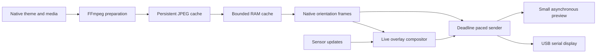

# JONSBO compatibility and performance notes

Date: 2026-10-30. Scope: the user's installed software, owned USB display, and public theme resources, for an independent compatible controller. No firmware modifications or writes to the installed application's executable were made.

## Evidence and findings

The installed managed assembly identifies as `Vmax, Version=1.0.2.17`. Examined executable SHA-256: `C522DB75D6E1E847B1493C88EEB04B3F3399F7EC11F67930012C91C8919662FE`.

Ordinary offline decompilation encountered protected method bodies. Read-only inspection of the loaded main managed module allowed reconstruction for analysis. An offline analysis copy initialized constants without running its anti-tamper/anti-debug startup. Constant resolution also required accounting for calling-assembly checks. Analysis copies and proprietary decompiled output stay under ignored `work`; the replacement uses independently written implementation code.

| Evidence | Finding | Implementation |
| --- | --- | --- |
| Device discovery and stock transport call flow | Supported CDC devices use VID 33C3 with PIDs 7788, F101, 0E02 or F102 | Restricted discovery in JonsboTransport.cs |
| COM12 query response | `VMAXB160462*1920S255201497`, native 462 × 1920 | Native portrait output, logical landscape editing |
| Transport inspection and successful playback | Query bytes F0 A5 5A 0F; response ASCII; stream raw JPEG frames | SerialPort 9600/8N1, DTR enabled; no Thermalright framing |
| User observed upside-down output, then confirmed correction | Connected VMAXB requires automatic output rotation 270° from logical landscape | Model-specific Auto profile; manual overrides retained |
| Theme round trips | Native packages are password-protected ZIPs containing JSON/media and sometimes Setting.txt/fonts | Portable import/export, unknown-field preservation, bounded extraction |
| Stock loop and replacement benchmarks | Sleeping after work adds rendering/transfer time to the frame interval | Fixed deadlines, prepared frames, independent compositor/sender/preview |

The archive password is a format compatibility constant, not an account credential. Native Type 1 layout parsing handles text, source PNG layers and basic rectangles. Bundled theme fonts are loaded for editor and output rendering. Static layers below live sensor text are baked into the prepared video cache, preserving their order while keeping frame composition fast. Other advanced vendor widgets remain an explicit limitation. Basic rectangles export as transparent native PNG layers, with grouping by z position.

## Pipeline

Preparation runs at source cadence without real-time throttling. Playback reuses prepared JPEGs when no live overlay changes are needed. A separate compositor supplies the newest completed frame without holding up output. The preview decodes/draws at a small size and pauses when not visible. Persistent cache keys include preparation settings; RAM and disk limits bound retained data.

## Validation timeline

1. Measured the installed process over eight seconds: 6.87% total CPU, 529.3 MB working set, 776.3 MB private memory.
2. Reconstructed native theme and transport behavior; queried the owned display on COM12.
3. Implemented native import/export, editor, library, public catalog and prepared playback.
4. Passed archive round-trip, unknown-field/media preservation, JPEG color, portrait rotation, RAM spill, persistent-cache reopening and cached pacing checks.
5. Passed UI editor add/update/undo/redo/save checks. Verified basic shapes export and re-import as native image layers with resolvable files.
6. Cached NIER benchmark: 59.80 FPS output, 0.06% host CPU, 81.8 MB host RAM. Sensor theme benchmark: 60.00 FPS output, 0.86% host CPU, 73.1 MB host RAM.
7. Visible full UI benchmark: about 59.7–59.9 FPS output and 58–60 FPS preview. Combined host/WebView sample: 2.13% total CPU and 411.9 MB aggregate private memory.
8. Corrected VMAXB rotation after physical feedback. Owner confirmed: “Yes, upright and playing.”
9. Identified DS339 as `USB\VID_345F&PID_9132&MI_03`, a MacroSilicon display interface rather than a COM port. The installed SDK attached with 376 × 960 timing and reported serial `VMAXB010376*0960S261301173`. A separate transport now sends native frames through that SDK. Static theme: 60.00 FPS output, 0.62% host CPU, 70.9 MB RAM. Video theme: 59.80 FPS output, 0.84% host CPU, 75.9 MB RAM. Owner confirmed the physical DS339 theme is upright and playing.
10. Ran DS916 and DS339 together through separate playback engines: both measured 60.0 host submissions/s over five seconds. Saved independent settings and themes, restarted the app with both marked for resume, and confirmed simultaneous DS916 serial and DS339 SDK activity. Owner reported both physical screens playing correctly.

CPU samples normalize across 20 logical processors. Cache-warm benchmarks do not include initial FFmpeg preparation. Samples are short and workload dependent. USB metrics describe completed host submissions, not independently measured panel refresh. Source video below 60 FPS repeats frames. Device behavior after host exit remains unverified for JONSBO.

## Public theme sources

The official public community listing is served by `theme.screen-aio.com`; downloadable built-in packages were verified at `res.hlinel.com/static/upload/other/soft/jsbThemes/`, including the 916 and 339 collections. The bundled manifest contains 29 verified packages and their previews. Account/points-gated community downloads remain official-page links. No embedded private application API secret is used.

## Remaining compatibility work

Advanced vendor animation widgets and additional sensor providers need further implementation and device testing. Successful native file round trips do not establish pixel-identical behavior in every version of the official app. No firmware modification or standalone device playback capability is claimed.
